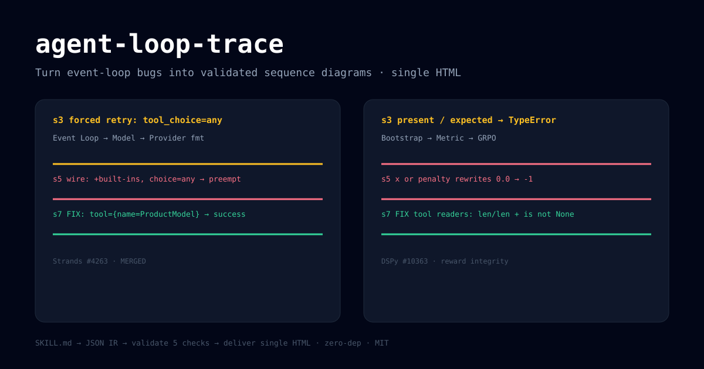

# agent-loop-trace

**把 Agent event-loop 的 bug 变成一张可验证、可转发的时序图 — 单文件 HTML，零依赖。**

`SKILL.md → JSON IR → validate 5项 → deliver 单文件HTML`，学 Archify 链路的最小复刻，切更窄的 Agent 调试痛点。

[English](./README_EN.md) · MIT · `node >= 18`



## 为什么做

Archify（64k star）证明了 `可验证 + 好看 + 易转发` 能上 Trending，但它是通用架构图。这个项目只做一件事：**loop forcing / retry / preemption 的可视化**，每个图都连回一个真实 PR 和面试故事：

- `strands-forcing`：Strands #4263 已合并 — `tool_choice=any` 被 provider 内置工具抢占，改按名强制
- `dspy-reward`：DSPy #10363 — `present/expected` 列表相除 crash + `0.0 or penalty` 改写 reward

## 快速开始

```bash
node bin/trace.mjs doctor
node bin/trace.mjs validate examples/strands-forcing.json --json
node bin/trace.mjs deliver examples/strands-forcing.json /tmp/loop-trace/demo.html --json
# 用浏览器打开 /tmp/loop-trace/demo.html：T 切主题，E 导出 PNG
```

在线例子（本地打开）：`examples/rendered/strands.html`、`examples/rendered/dspy.html`

## Agent Skill 用法

把本仓库放到你的 skill 目录（Claude Code / Codex / opencode 均支持 `SKILL.md`），然后在对话里说：

```
用 agent-loop-trace 把这段 event-loop 日志画成时序图，重点标出 forced retry。
```

Skill 会先写 candidate JSON，再跑 5 项校验（shape / participants / refs+seq / highlight / label），全过才 deliver。

## 路线

- v0.1 ✅：sequence 一种图，5 项校验，深浅色切换，PNG 导出，分享卡复制
- v0.2：LiteLLM minimal-flag 第三例子、画廊页、CLI `guide` 一句话选图
- v1.0：hero PNG 1200×630、Trendshift 徽章、推上发 Proof

## 致谢

链路设计学自 [tt-a1i/archify](https://github.com/tt-a1i/archify)（MIT），renderer 与 validator 为独立实现。
