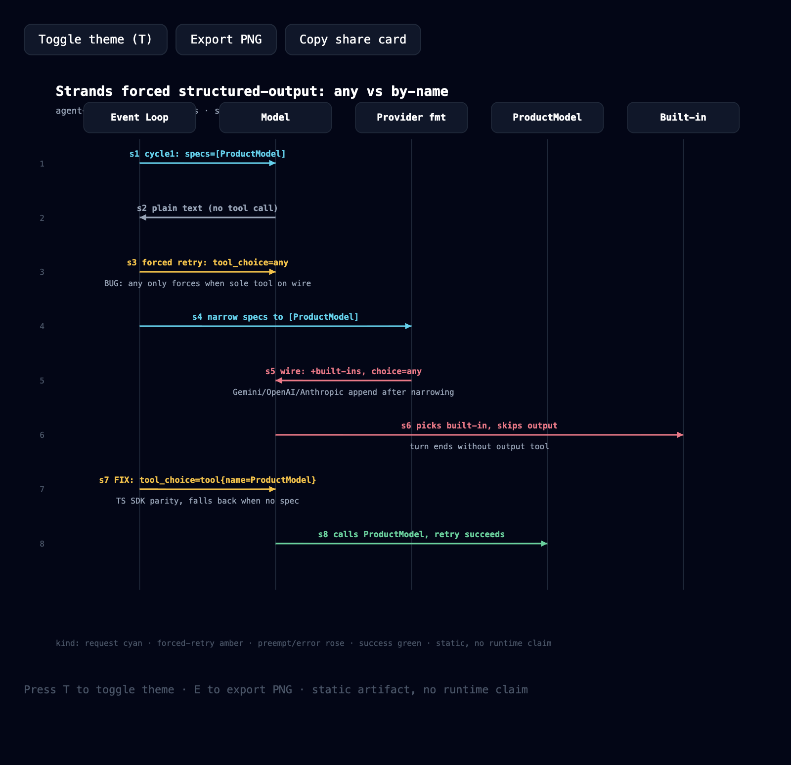

# agent-loop-trace

**Turn an agent event-loop bug into a validated, shareable sequence diagram — single HTML, zero deps.**

`SKILL.md → JSON IR → validate 5 checks → deliver single HTML`. A minimal Archify-style clone scoped to agent debugging.

[中文](./README.md) · MIT · `node >= 18`




## Why

Archify (64k stars) proved `verifiable + beautiful + shareable` hits Trending, but it covers generic architecture. This repo does one thing: **visualize loop forcing / retry / preemption**, each diagram backed by a real PR:

- `strands-forcing`: Strands #4263 (merged) — `tool_choice=any` preempted by provider built-ins, fixed by-name
- `dspy-reward`: DSPy #10363 — list/list crash + `0.0 or penalty` reward corruption

## Quick start

```bash
node bin/trace.mjs doctor
node bin/trace.mjs validate examples/strands-forcing.json --json
node bin/trace.mjs deliver examples/strands-forcing.json /tmp/loop-trace/demo.html --json
# Open in browser: T toggles theme, E exports PNG
```

Prebuilt: `examples/rendered/strands.html`, `examples/rendered/dspy.html`

## As an Agent Skill

Drop this repo into your skill dir (Claude Code / Codex / opencode all read `SKILL.md`), then say:

```
Use agent-loop-trace to diagram this event-loop log, highlighting the forced retry.
```

The agent writes a candidate JSON first, runs all 5 checks (shape / participants / refs+seq / highlight / label), and only delivers on pass.

## Roadmap

- v0.1 ✅: one diagram type, 5 checks, dark/light, PNG export, share-card copy
- v0.2: third example (LiteLLM minimal-flag), gallery page, `guide` helper
- v1.0: 1200×630 hero PNG, Trendshift badge, public Proof posts

## Credits

Chain design learned from [tt-a1i/archify](https://github.com/tt-a1i/archify) (MIT); renderer and validator are independent implementations.
